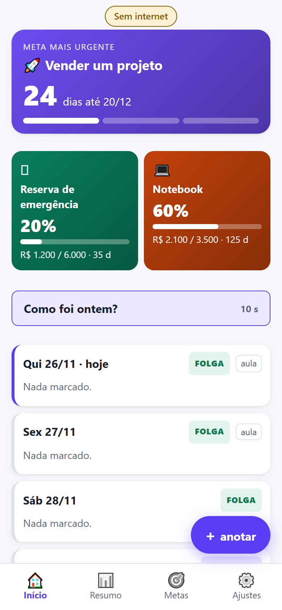
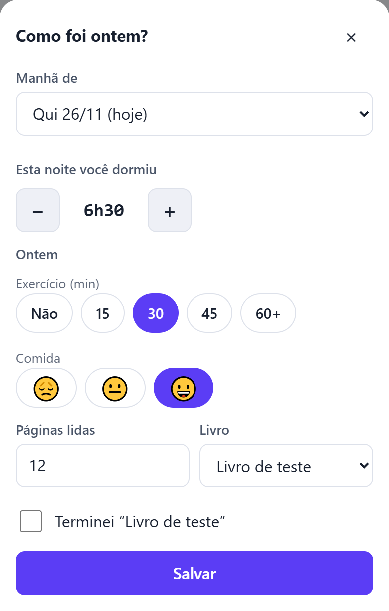
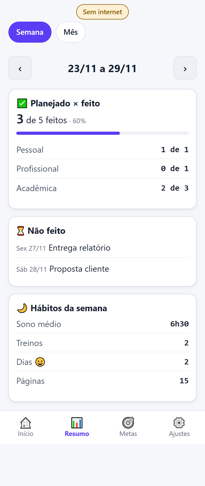
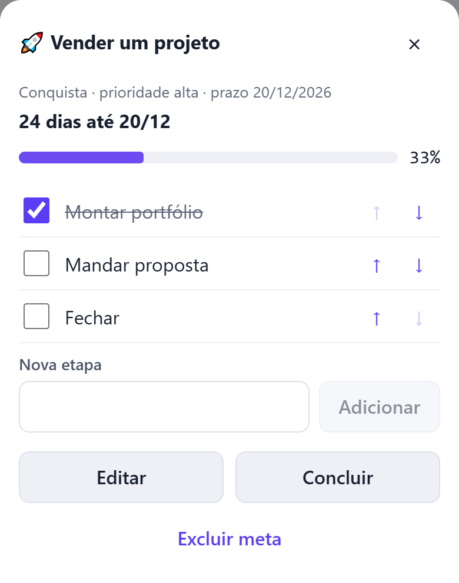

# Vida Pessoal

App pessoal para planejar a semana e não ser pego de surpresa: provas, entregas, compromissos, tarefas, hábitos e metas num lugar só, ajustado à escala de trabalho.

No ar: <https://vida-pessoal-yuop.vercel.app/> (instalável no celular, funciona sem internet).

| Início | Registro do dia | Resumo da semana | Meta |
|---|---|---|---|
|  |  |  |  |

*Prints com dados fictícios.*

## O que ele faz

- **Escala de trabalho configurada uma vez** (6x1, 5x2, 4x3, 12x36, 3x2 alternado ou um ciclo montado à mão). O app calcula sozinho os dias de trabalho e de folga. Dia extra, férias e trocas viram exceções.
- **Linha do tempo** dos próximos dias, com TRABALHO/FOLGA, "aula" e os itens de cada dia. Provas, entregas e compromissos aparecem com ⚠.
- **"+ anotar" em uma linha:** `prova química 20/11`, `entrega relatório sexta`, `dentista amanhã 14h`. O app entende tipo, data e hora.
- **Treino nas folgas** (opcional) e **tarefas repetidas** (todo dia, nas folgas ou nos dias de trabalho).
- **Avisos no celular** com antecedência: prova 7, 3, 1 dia antes e no dia; entrega 3, 1 e no dia; compromisso na véspera e 1 hora antes; metas de prioridade alta 30 e 7 dias antes; e o lembrete do registro do dia. Tudo agrupado numa notificação só.
- **Registro do dia em ~10 segundos:** sono, exercício, comida e leitura, já preenchido com o último registro.
- **Resumos:** a semana (planejado × feito, o que ficou para trás, hábitos) e o mês (sono antes de trabalho × antes de folga, treinos, comida, leitura).
- **Metas** com prazo, prioridade e tipo (conquista com etapas, valor ou compra). As de prioridade alta ficam no Início, a mais urgente em destaque.

## Como funciona por dentro

- **Front-end:** React + TypeScript + Vite, instalável (PWA). Publicado pela Vercel a cada push na `main`.
- **Dados:** Supabase (Postgres com RLS: cada pessoa só enxerga as próprias linhas). Login com e-mail e senha; o cadastro público fica desligado.
- **Sem internet:** o app guarda uma cópia dos dados no aparelho (IndexedDB) e uma **fila** do que foi mudado. Quando a internet volta (ao abrir o app, ao reconectar ou a cada minuto), a fila é enviada e o que mudou no servidor é baixado. Se o mesmo registro mudou em dois lugares, vale a alteração mais recente. Ajustes, login e exportar precisam de internet.
- **Notificações:** a cada 15 minutos o `pg_cron` do Supabase chama a Edge Function `enviar-notificacoes`, que calcula os avisos no fuso de São Paulo, manda uma notificação por aparelho (Web Push) e anota o que já enviou para não repetir.
- **Regras puras** (escala, anotar, agenda, avisos, resumos, metas) ficam em `src/regras/`, com testes. A Edge Function usa uma cópia delas.

## Rodar no computador

Precisa do Node 22 ou mais novo.

```bash
npm install
npm run dev      # abre em http://localhost:5173
npm test         # testes das regras
npm run build    # gera a versão de produção em dist/
```

Não precisa de `.env`: o endereço do projeto Supabase, a chave **publicável** e a chave **pública** das notificações estão no código (`src/supabase.ts` e `src/pwa/push.ts`). Todas são públicas por natureza (vão para qualquer navegador que abre o app). A proteção dos dados é o login + RLS.

> No Windows, se o PowerShell recusar o `npx`, use `npx.cmd`.

## Supabase

Projeto `jnhuuhrzebxfminnhfiz`. A Supabase CLI roda pelo `npx` (sem instalar nada) e já está ligada ao projeto nesta pasta.

- **Mudanças no banco** só por arquivos em `supabase/migrations/`, aplicados com `npx supabase db push --remote`.
- **Publicar a Edge Function:** `npm run deploy:funcoes` (copia `src/regras/` para a função e faz o deploy).

### O projeto pausou?

No plano grátis, o Supabase **pausa o projeto depois de 7 dias sem uso**. O app abre, mas não sincroniza nem manda avisos. Para reativar: entrar em <https://supabase.com/dashboard>, abrir o projeto e tocar em **Restore project**. Em alguns minutos volta tudo, sem perder dados. Usar o app todo dia evita a pausa.

### Segredos

Ficam **só** no Supabase, nunca no código nem no GitHub:

- Da Edge Function (`npx supabase secrets list` mostra os nomes): `VAPID_PUBLICA`, `VAPID_PRIVADA`, `VAPID_CONTATO` e `CRON_SEGREDO`.
- No cofre do banco (Database → Vault): `cron_segredo` (igual ao `CRON_SEGREDO`) e `url_funcao_notificacoes`.

Para trocar um segredo: `npx supabase secrets set NOME=valor`. Se trocar o `CRON_SEGREDO`, troque também o `cron_segredo` do cofre. Se trocar as chaves VAPID, atualize a chave pública em `src/pwa/push.ts` (os aparelhos se reinscrevem sozinhos ao abrir o app).

## Backup

Ajustes → **Exportar dados** gera um arquivo com tudo (no celular, abre a tela de compartilhar). O plano grátis do Supabase não faz cópia automática: guarde uma de vez em quando.

## Teste manual

O roteiro para conferir no celular está em [docs/teste-manual.md](docs/teste-manual.md).
